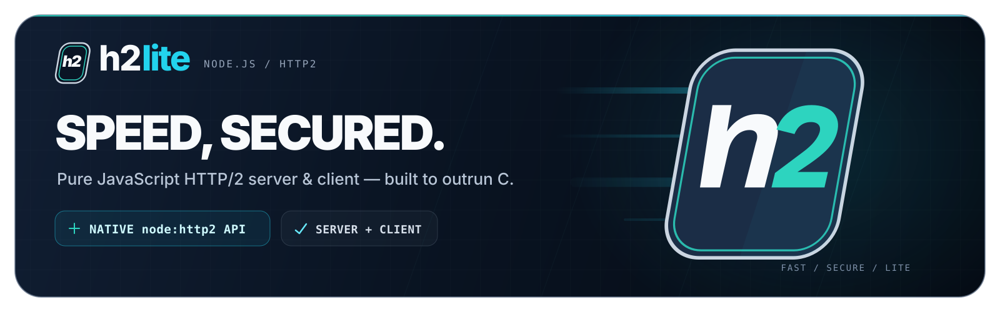

<div align="center">



### The pure-JavaScript HTTP/2 stack for Node.js

**Drop-in replacement for `node:http2` — without the nghttp2 C layer.**

[](https://www.npmjs.com/package/h2lite)
[](https://nodejs.org)
[](package.json)
[](LICENSE)

Up to **8× less CPU per request** and **6.8× more requests per second** than `node:http2` — measured, paired, and reproducible. Outperforms even uWebSockets (C++) at header-bound HTTP/2 workloads.

</div>

---

## 📑 Table of Contents

- ⚡ [Why h2lite?](#-why-h2lite)
- 🏎️ [Performance](#️-performance)
- 🔌 [Compatibility — Drop-in Replacement](#-compatibility--drop-in-replacement)
- 📦 [Installation](#-installation)
- 🚀 [Getting Started](#-getting-started)
  - [Server — the `(req, res)` API](#server--the-req-res-api)
  - [Server — the raw `Http2Stream` API](#server--the-raw-http2stream-api)
  - [Secure server (h2s / TLS)](#secure-server-h2s--tls)
  - [Client — `connect()`](#client--connect)
  - [Fastify and other frameworks](#fastify-and-other-frameworks)
  - [Monkey-patching for frameworks without injection](#monkey-patching-for-frameworks-without-injection)
- 🛠️ [Advanced Tuning](#️-advanced-tuning)
- 🔒 [Security](#-security)
- ⚠️ [Not Implemented — Said Loudly](#️-not-implemented--said-loudly)
- 📚 [Documentation](#-documentation)
- 🤝 [Contributing](#-contributing)
- ⚖️ [License](#️-license)

## ⚡ Why h2lite?

Node's native `node:http2` (stable since v10.10.0) has a fundamental architectural constraint: every HTTP/2 frame crosses the JS ↔ C++ boundary between V8 and bundled nghttp2. Frame dispatch, HPACK encoding/decoding, and flow-control bookkeeping all pay for that crossing — on every single frame of every single request.

**h2lite removes the crossing entirely.** The entire protocol — frame parsing, HPACK (RFC 7541), flow control, connection state machines — lives in pure JavaScript, tuned item by item against measured data ([OPTIMIZATION.md](./OPTIMIZATION.md), 35 numbered techniques). Zero native code, zero runtime dependencies.

The result is a library that keeps `node:http2`'s exact public surface while spending dramatically less CPU per request. Perfect for:

- 🧩 **Microservices** — header-heavy service-to-service traffic is where the gap is widest
- 📡 **gRPC servers** — many small streams, all header-bound
- 🤖 **AI backends** — long-lived streams, high connection counts, every CPU cycle matters
- 🔁 **Behind a reverse proxy** — pair h2lite with an HTTP/2-terminating edge and stop paying for HTTP/1.1

## 🏎️ Performance

Every number below is `node`'s own per-request CPU time (μs/req, read inside the process — the metric that travels) or requests per second, measured with [h2load](https://nghttp2.org/documentation/h2load.1.html) against six honest responder arms on the same machine in the same session. Full methodology, caveats and re-run instructions: **[PERFORMANCE.md](./PERFORMANCE.md)**.

**Server, headers-only workload** (the workload HTTP/2 exists for):

| Server | μs/req | req/s | CPU vs `node:http2` |
|---|--:|--:|--:|
| node:http (HTTP/1.1) | 9.11 | 111,816 | 1.21× |
| uWebSockets C++ (HTTP/1.1) | 4.87 | 203,283 | 2.27× |
| node:http2 (stream API) | 7.30 | 171,835 | 1.52× |
| **h2lite (stream API)** | **1.38** | **765,149** | **8.01×** |
| **h2lite (compat API)** | **2.85** | **367,275** | **3.88×** |

**Server, with response body:** 16 kB — **2.50× less CPU** than `node:http2` ([PERFORMANCE.md](./PERFORMANCE.md)). 256 kB — parity, as expected: the work is body-bound, and h2lite does not win by cutting corners.

**Client, same-server paired measurement** (`h2lite.connect()` vs `node:http2.connect()`, driven against nghttpd):

| Workload | node client μs/req | h2lite client μs/req | Advantage |
|---|--:|--:|---|
| Headers only | 12.08 | **3.61** | 3.35× |
| 16 kB | 19.66 | **11.73** | 1.68× |
| 256 kB | 148.70 | 134.24 | within noise |

> 💡 **Re-measure before quoting.** The project's own rule: an unpaired before/after run cannot separate a change from noise. Both benchmark matrices re-run with one command (`npm run bench:showcase`, `npm run bench:client`) — [bench/](./bench) has the arms, [CONTRIBUTING.md](./CONTRIBUTING.md) §3 has the method.

## 🔌 Compatibility — Drop-in Replacement

Compatibility target is the **public surface** of `node:http2`: names, argument shapes, event orders, wire-visible frame sequences, `rstCode`/`goawayCode` numbers — verified differentially. The test suite runs the **same application scripts** against both `node:http2` and h2lite and compares the transcripts ([test/diff-harness.js](./test/diff-harness.js)); [h2spec](https://github.com/summerwind/h2spec) conformance is 146/146 — the same verdict node's own HTTP/2 receives.

```diff
- const http2 = require('node:http2');
+ const http2 = require('h2lite');

  const server = http2.createServer((req, res) => {
    res.end('hello world');
  });
  server.listen(8080);
```

Same class names (`Http2Session`, `Http2Stream`, `Http2ServerRequest`, `Http2ServerResponse`), same event names, same `Http2Session` and settings semantics, all 240 protocol constants re-exported from `node:http2` itself — user code that compares `error.code !== http2.constants.NGHTTP2_ENHANCE_YOUR_CALM` keeps working unchanged. Both transports on both sides: `createServer` (h2c), `createSecureServer` (h2s), `connect()` over cleartext and TLS with node's ALPN rules.

Where behavior deliberately differs from node, it is **documented, measured, and pinned by tests** — never silent. Known divergences: [CONTRIBUTING.md](./CONTRIBUTING.md) §5.

## 📦 Installation

```bash
npm install h2lite
```

Requires Node.js **≥ 20** (verified against v26.12.1). Zero runtime dependencies — `lib/` imports nothing but `node:` builtins.

## 🚀 Getting Started

### Server — the `(req, res)` API

The compat API feels like HTTP/1.1 but speaks HTTP/2 — this is what replaces `node:http2` in an existing application:

```javascript
const http2 = require('h2lite');

const server = http2.createServer((req, res) => {
  // req is an Http2ServerRequest, res is an Http2ServerResponse
  res.writeHead(200, { 'content-type': 'text/plain' });
  res.end('hello from h2lite');
});

server.listen(8080);
```

### Server — the raw `Http2Stream` API

Maximum throughput: skip the compat objects entirely and work with streams and header maps:

```javascript
const http2 = require('h2lite');

const server = http2.createServer();

server.on('stream', (stream, headers) => {
  stream.respond({ ':status': 200, 'content-type': 'text/plain' });
  stream.end('hello from the stream API');
});

server.listen(8081);
```

### Secure server (h2s / TLS)

```javascript
const http2 = require('h2lite');

const server = http2.createSecureServer({
  key: require('fs').readFileSync('key.pem'),
  cert: require('fs').readFileSync('cert.pem')
});

server.on('stream', (stream, headers) => {
  stream.respond({ ':status': 200 });
  stream.end('secure h2');
});

server.listen(8443);
```

TLS decisions stay delegated to `node:tls` — ALPN is pinned to `h2` exactly the way node does it, and certificate handling is node's, not ours.

### Client — `connect()`

```javascript
const http2 = require('h2lite');

const session = http2.connect('http://localhost:8080');

const req = session.request({ ':path': '/', ':method': 'GET' });
req.on('response', (headers) => {
  console.log('status:', headers[':status']);
});
req.setEncoding('utf8');
req.on('data', (chunk) => console.log(chunk));
req.on('end', () => session.close());

req.end();
```

Works over `https://…` too — the client speaks both h2c and h2s.

### Fastify and other frameworks

Any framework that lets you hand it a server instance takes h2lite in two lines. Fastify's [`serverFactory`](https://fastify.dev/docs/latest/Reference/Server/#serverfactory):

```javascript
const Fastify = require('fastify');
const h2lite = require('h2lite');

const fastify = Fastify({
  http2: true,
  serverFactory: (handler) => {
    return h2lite.createServer((req, res) => handler(req, res));
  }
});

fastify.get('/', async () => ({ hello: 'from h2lite under Fastify' }));
fastify.listen({ port: 8080 });
```

### Monkey-patching for frameworks without injection

If a framework requires `node:http2` internally and offers no injection point, patch the builtin's exports **before anything else loads** — every later `require('node:http2')` receives the same (mutated) module object:

```javascript
// patch.js — require this first: node -r ./patch.js app.js
const nodeHttp2 = require('node:http2');
const h2lite = require('h2lite');

nodeHttp2.createServer = h2lite.createServer;
nodeHttp2.createSecureServer = h2lite.createSecureServer;
nodeHttp2.connect = h2lite.connect;
```

## 🛠️ Advanced Tuning

- ♻️ **Freeze reusable header objects.** `Object.freeze()` on a header set enables h2lite's per-connection response-block cache — the HPACK bytes are encoded once and copied afterwards. Measured **~25% CPU saved** on a headers-only workload ([PERFORMANCE.md](./PERFORMANCE.md)):

  ```javascript
  const HEADERS = Object.freeze({ ':status': 200, 'content-type': 'application/json' });
  server.on('stream', (stream) => stream.respond(HEADERS));
  ```

- 📏 **Raise `initialWindowSize`** for high-throughput downloads (see the [settings object reference](https://nodejs.org/api/http2.html#settings-object)) — default flow-control windows are conservative and will throttle bulk transfer.
- 🌊 **Prefer more streams per connection over more connections.** HPACK state, one staging buffer and one dynamic table are per-connection: amortize them by multiplexing, not by fanning out sockets.
- 🔍 **Read the playbook.** [OPTIMIZATION.md](./OPTIMIZATION.md) documents 35 measured techniques — and the ones that were tried and rejected, so you don't re-invent them.

## 🔒 Security

h2lite terminates **untrusted bytes from the internet** and turns them into objects your application trusts — the threat model is treated as the primary design constraint ([SECURITY.md](./SECURITY.md)):

- 🛡️ **Every denial-of-service limit matches nghttp2** (the engine inside node) or was measured against a live node server — a peer's budget against node is its budget against h2lite: SETTINGS-entry cap (CVE-2020-11080), CONTINUATION cap (CVE-2024-28182), rapid-reset budget (CVE-2023-44487), outbound staging, parked-stream and history bounds.
- 🚫 **Request-smuggling defense by construction** (RFC 9113 §10.3): field names must be lower-case tokens, values may not carry NUL/CR/LF, connection-specific fields are refused in both directions — all refused at encode time, *before a single octet reaches the wire*. h2lite is stricter than node here, deliberately and measurably.
- ✅ **Verified, not assumed:**
  - **300+ differential tests** — application scripts run against both `node:http2` and h2lite, transcripts compared;
  - **h2spec 146/146** — full RFC 9113/7541 conformance, same verdict as node's own HTTP/2 (`npm run spec`);
  - **mutation-tested guards** — every defensive limit is rewritten in place and proven to fail the suite ([tools/mutate-guards.js](./tools/mutate-guards.js)).

## ⚠️ Not Implemented — Said Loudly

Two APIs are absent, and both fail **loudly** with `ERR_H2LITE_NOT_IMPLEMENTED` — never a silent wrong answer:

- **Server push** — removed from browsers in 2022 and considered obsolete; the safer replacement is [Early Hints (103)](https://developer.mozilla.org/en-US/docs/Web/HTTP/Reference/Status/103).
- **`performServerHandshake`** — no known use case outside node's own tests.

## 📚 Documentation

| Document | What it holds |
|---|---|
| [PERFORMANCE.md](./PERFORMANCE.md) | 🏎️ Benchmarks: methodology, full tables, caveats, re-run commands |
| [SECURITY.md](./SECURITY.md) | 🔒 Threat model, every hardening limit, known gaps — stated plainly |
| [OPTIMIZATION.md](./OPTIMIZATION.md) | 🔬 All 35 measured optimization techniques (and rejected ones) |
| [CHANGELOG.md](./CHANGELOG.md) | 📋 Release history, Keep-a-Changelog format |
| [CONTRIBUTING.md](./CONTRIBUTING.md) | 🧪 Testing, benchmarking and commit rules for contributors |

## 🤝 Contributing

Contributions are welcome! The project holds itself to an unusual standard and expects the same from patches:

- **"node behaves this way" needs proof** — read from node's bundled source or measured off a live server, not recalled ([CONTRIBUTING.md](./CONTRIBUTING.md) §3).
- **"it's faster" needs a paired benchmark** — same session, same shape, ABBA-interleaved.
- `npm test` (300+ differential tests) and `npm run lint` must be green before a commit lands.

Good first contributions: fuzzing harness (start from [tools/probe-wire.js](./tools/probe-wire.js)), more differential scenarios in [test/](./test), documentation.

## ⚖️ License

[Apache-2.0](./LICENSE)
